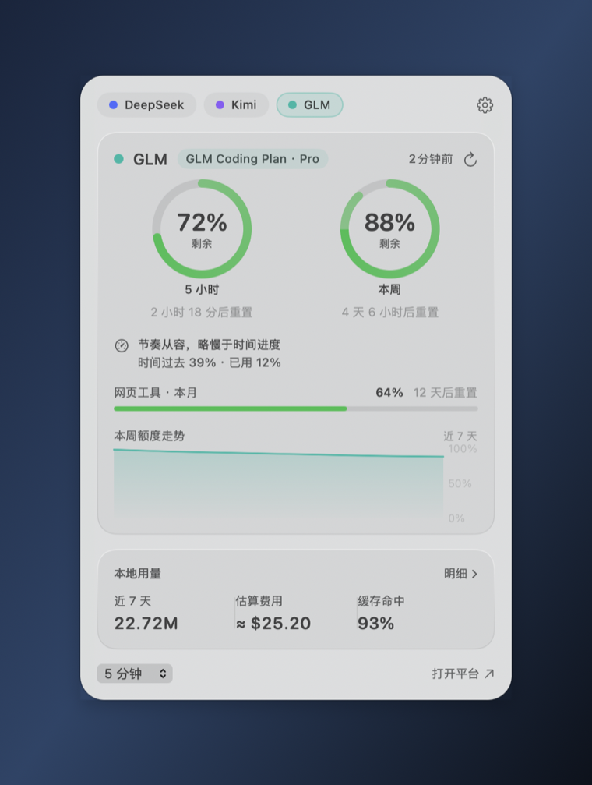
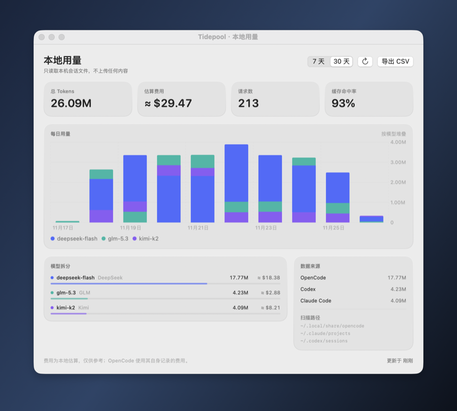
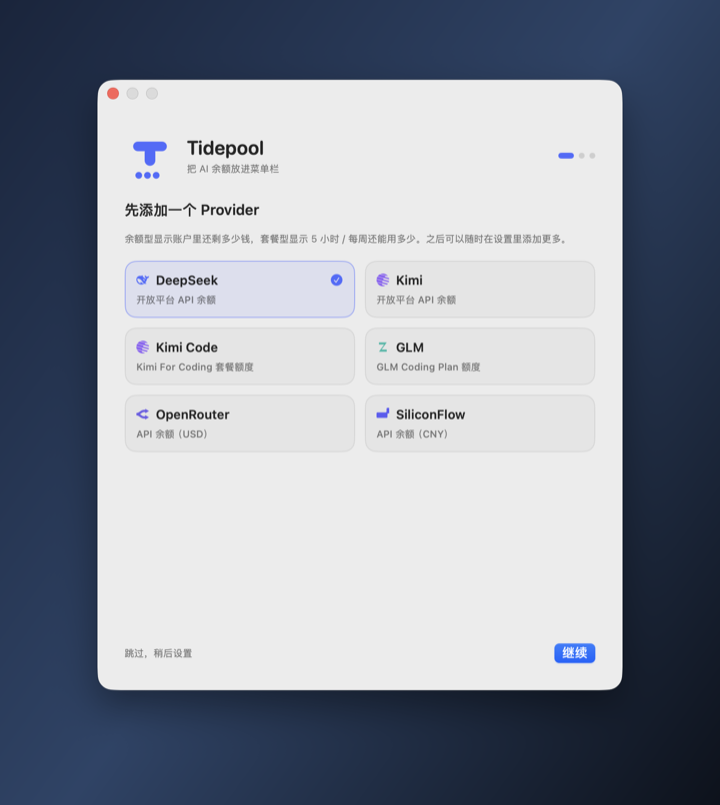

# Tidepool 🌊

[](https://github.com/PinelliaAzure/Tidepool/actions/workflows/ci.yml)

> Your AI budget, at a glance. · 让每一分余额，都有潮汐。

macOS 菜单栏里的多平台 AI 余额与余量仪表盘：品牌图标旁边是你的余额，点开是一整片玻璃面板。

<p align="center">
  
  
</p>

- **多平台**：DeepSeek / Kimi / Kimi Code / GLM / OpenRouter / SiliconFlow / 火山方舟 / 阿里云百炼 / 腾讯云 / 华为云；还能用「自定义」接入任意只读 JSON 接口
- **余额与额度**：API 余额、Coding Plan 5 小时 / 周额度、自定义百分比
- **实时计价**：DeepSeek 工作日高峰为标准价、其余时段 5 折；金额下方橙 / 青状态线 + 24h 时段条
- **额度节奏**：用「时间进度 vs 用量进度」判断会不会提前用完，而不只给一个百分比
- **潮汐图**：余额采样的 7 / 30 天水位曲线，附日均消耗与 runway
- **本地用量**：读取 OpenCode / Claude Code / Codex 的本机会话，按模型 / 工具拆分 tokens 与估算费用，支持 CSV
- **隐私优先**：Key 只进钥匙串，数据只落本机，无遥测；一键隐私模式隐藏金额
- **原生质感**：AppKit + SwiftUI，跟随 Liquid Glass / 明暗 / 降低透明度
- **中英双语**：跟随系统语言，也可在设置里手动切换（重启生效）

| 本地用量 | 首次启动 |
|---|---|
|  |  |

## 功能

### 菜单栏
- 当前 Provider 的品牌图形 + 等宽数字金额；额度型显示剩余百分比
- 三种展示方式：当前 Provider / 全部紧凑 / 最紧张的一项
- 单色模板图标（自动适配壁纸与明暗）或彩色品牌图标
- DeepSeek 标准价时金额下方为橙色状态线，闲时为青色；每 30 秒与时段切换点实时更新
- Provider 支持拖拽排序；低余额时出现告警点；右键菜单可刷新、打开用量、切换隐私模式、检查更新

### 面板
- Provider 胶囊 Tab、Hero 余额、赠送 / 充值构成条
- 7 / 30 天余额潮汐图，今日消耗、7 天日均、预计可用天数
- 套餐型 Provider：5 小时 / 本周双圆环 + 重置倒计时 + 节奏判断 + 额度走势
- 本地用量摘要卡，点「明细」打开完整用量窗口
- DeepSeek 计价时段卡：24h 时段条、当前闲时 / 标准价、下次切换倒计时

### 计价时段
DeepSeek 官方规则（2026-11）：

- 标准价：北京时间工作日 09:00–12:00、14:00–18:00
- 闲时：其余时段 5 折，周末全天闲时
- 法定节假日以官方价格页为准（应用不内置节假日表，避免过期误报）

菜单栏用金额下方的 2px 状态线表示（不是角标）：橙色 = 标准价，青色 = 闲时；tooltip 显示下次切换时间。
架构上 `ProviderPricing.schedule(for:)` 支持给其他 Provider 增加时段规则；目前只有 DeepSeek 有官方闲时定价。

### 云厂商
这几家没有简单的 Bearer 余额接口，Tidepool 通过官方 CLI 读取，不保存 AK/SK：

| Provider | 读取内容 | 凭据方式 |
|---|---|---|
| 火山方舟 | Coding Plan 5h / 周 / 月额度 | 本机 `arkcli`（设置里有「浏览器登录」按钮） |
| 阿里云百炼 | Coding Plan 5h / 周 / 月额度 | 本机 `bl`（设置里有「浏览器登录」按钮） |
| 腾讯云 | 账户可用余额（分转元） | App 内填 SecretId / SecretKey（TC3 签名，存钥匙串） |
| 华为云 | 账户余额 / 奖励金 | App 内填 Access Key / Secret Key（存钥匙串） |

火山/阿里没有公开的 Coding Plan 额度 API，所以保留官方 CLI；点「浏览器登录」会打开官方 SSO。
腾讯/华为不再需要 CLI，Tidepool 直接签名请求账单 API。

### 自定义接入
设置 → 添加 Provider → 自定义：

- `Endpoint`：完整只读 URL（支持 `https://` / `http://`）
- 鉴权：Bearer Token / 原始 Token / 无鉴权
- 取值：余额路径（如 `data.balance`），或百分比路径（如 `data.limits.0.remaining_percent`，可标记「已用」），或剩余量 + 总量路径
- 重置时间：可选，支持毫秒 / 秒时间戳或 ISO8601
- 点路径用 `.` 访问 JSON，数组用数字下标

### 本地用量
- 只读解析，不上传：`~/.local/share/opencode`、`~/.claude/projects`、`~/.codex/sessions`
- 每日堆叠柱状图、模型拆分、缓存命中率、数据来源
- 费用优先使用 OpenCode 自带记录；其余按内置价格表估算并标注
- CSV 导出（时间、工具、Provider、模型、项目、输入 / 输出 / 缓存、费用）

### 提醒与隐私
- 余额 < ¥10 或额度 < 10% 时发系统通知，每个周期只提醒一次，重启不重复
- 隐私模式隐藏菜单栏金额、余额、图表刻度、runway 与费用

## 下载

[GitHub Releases](https://github.com/PinelliaAzure/Tidepool/releases/latest) 提供 `Tidepool-0.4.6.dmg` 与 `.zip`。

> **请务必把 Tidepool 拖进「应用程序」再打开，不要直接从 DMG 运行**——推出磁盘映像会导致正在运行的 App 崩溃。
>
> 发布包为 ad-hoc 签名，未做 Apple 公证。首次打开若被 Gatekeeper 拦截：
> 右键 App →「打开」，或执行 `xattr -dr com.apple.quarantine /Applications/Tidepool.app`。

## 安装与运行

需要 macOS 14+ 与 Swift 5.9+（完整 Xcode 或 Command Line Tools 均可）。

```bash
make app          # 打包 build/Tidepool.app
open build/Tidepool.app

make test         # 64 个单元测试（Swift Testing）
make build        # 只编译
```

首次启动会打开引导：选 Provider → 粘贴 Key 并测试连接 → 选菜单栏样式。之后可在设置里重新运行引导。

### 无 Key 预览（假数据，不读写真实账户）

```bash
swift run Tidepool --preview            # 余额视图
swift run Tidepool --preview-quota      # 额度视图
swift run Tidepool --preview-usage      # 本地用量窗口
swift run Tidepool --preview-onboarding # 首次启动引导
swift run Tidepool --preview-settings   # 设置窗口
swift run Tidepool --preview --preview-privacy  # 隐私模式
swift run Tidepool --demo-menu-bar      # 真实菜单栏 + 假数据（调试用）
```

> 纯 Command Line Tools 环境下，macOS 27 SDK 缺少 SwiftUI 宏插件（`SwiftUIMacros`），
> `Makefile` / `build-app.sh` 会自动回退到 MacOSX26.5 SDK；安装了完整 Xcode 则无需处理。

## 数据来源

| Provider | 内容 | 接口 | 状态 |
|---|---|---|---|
| DeepSeek | 账户余额（总额 / 赠送 / 充值） | `GET https://api.deepseek.com/user/balance` | ✅ 官方文档 |
| Kimi / Moonshot | API 余额（可用 / 代金券 / 现金） | `GET https://api.moonshot.cn/v1/users/me/balance` | ✅ 官方文档 |
| Kimi Code | 5h / 周套餐余量 | `GET https://api.kimi.com/coding/v1/usages` | ⚠️ 非公开只读接口 |
| GLM / Z.ai | Coding Plan 5h / 周 / MCP 月度额度 | `GET https://open.bigmodel.cn/api/monitor/usage/quota/limit`（国际 `api.z.ai`） | ⚠️ 非公开只读接口 |
| OpenRouter | API credits（USD） | `GET https://openrouter.ai/api/v1/credits` | ✅ 官方接口 |
| SiliconFlow | 账户余额（CNY） | `GET https://api.siliconflow.cn/v1/user/info` | ✅ 官方接口 |
| 火山方舟 | Coding Plan 5h / 周 / 月 | 本机 `arkcli`（登录后） | ✅ 官方 CLI |
| 阿里云百炼 | Coding Plan 5h / 周 / 月 | 本机 `bl`（登录后） | ✅ 官方 CLI |
| 腾讯云 | 账户余额（CNY） | `billing.tencentcloudapi.com` + TC3 签名 | ✅ 官方 API |
| 华为云 | 账户余额（CNY） | `bss.myhuaweicloud.com` + AK/SK 签名 | ✅ 官方 API |
| 自定义 | 任意只读 JSON | 用户配置 endpoint + 点路径 | ✅ 自建 |

所有接口均为只读，不消耗额度；不做网页登录 / session 抓取。
非公开接口没有稳定性承诺，解析器已做缺字段容错，失败时保留上次数据并提示。

## 隐私

- API Key 仅存于 macOS 钥匙串（`dev.pinellia.tidepool`），不写入任何文件，也不在界面回显
- 账户配置与采样保存在 `~/Library/Application Support/Tidepool/`
- 本地用量只读取会话中的 token / 模型 / 费用字段，不读取对话内容，不上传
- 应用无任何分析 / 遥测 / 第三方上传

## 项目结构

```
Sources/Tidepool/
├─ App/            菜单栏外壳、Popover、设置 / 用量 / 引导窗口
├─ Core/
│  ├─ Providers/   DeepSeek / Kimi / GLM / OpenRouter / SiliconFlow / 自定义适配器
│  ├─ Store/       AppStore、轮询调度
│  ├─ Usage/       本地会话扫描、聚合、价格估算、CSV
│  ├─ Quota/       额度节奏
│  └─ Notifications/
├─ DesignSystem/   玻璃卡片、圆环、T 字标与 Provider 图标
├─ Features/       Popover / Settings / Usage / Onboarding
└─ Persistence/    Keychain、采样与偏好
```

## 状态与发布清单

- **M0 ✅** 菜单栏 + 玻璃面板 + DeepSeek / Kimi 余额 + 潮汐图 + runway
- **M1 ✅** GLM / Kimi Code 额度 + 双环 + 节奏 + 通知 + 菜单栏多模式 + Provider 排序
- **M2 ✅** 自定义 JSON 接入、OpenRouter / SiliconFlow、Onboarding + 本地用量（OpenCode / Claude Code / Codex）+ CSV + 额度历史 + 隐私模式 + DeepSeek 闲时计价
- **M3（本地）✅** 火山 / 阿里 / 腾讯 / 华为（官方 CLI） 拖拽排序、重置前提醒、中英双语、T 字标应用图标、Provider 品牌图标、检查更新入口
- **M3 ⏳（需要账号/仓库）** Developer ID 签名 + 公证、Sparkle appcast、Homebrew Cask
  - 先改 `Sources/Tidepool/Core/Updates/UpdateChecker.swift` 里的仓库地址
  - 证书与 notarytool 凭据就绪后，在 `build-app.sh` 基础上补签名 / 公证步骤

## License

MIT
