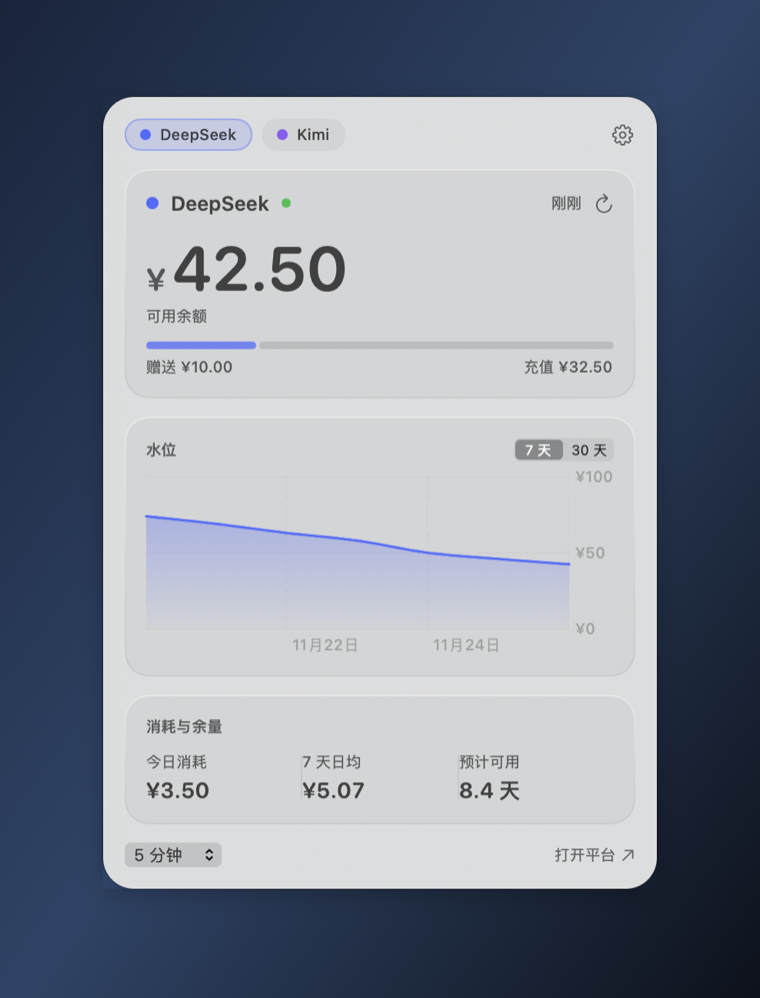

# Tidepool 🐋

> Your AI budget, at a glance. · 让每一分余额，都有潮汐。

macOS 菜单栏里的大模型余额与余量仪表盘：鲸鱼旁边是你的余额，点开是一整片玻璃面板。



- **余额优先**：DeepSeek / Kimi 的账户余额，GLM / Kimi Code 的套餐余量（M1）都在菜单栏一眼可见
- **潮汐图**：余额采样的 7 天 / 30 天水位曲线
- **Runway**：日均消耗与「还能用几天」的预测
- **本地优先**：API Key 只进 macOS 钥匙串，数据只落本机，无遥测
- **原生质感**：SwiftUI + AppKit，跟随系统 Liquid Glass / 明暗 / 降低透明度

## 构建与运行

需要 macOS 14+ 与 Swift 5.9+（Xcode 或 Command Line Tools 均可）。

```bash
make app          # 打包 build/Tidepool.app
open build/Tidepool.app

make test         # 单元测试（Swift Testing）
make build        # 只编译

# 无 API Key 时预览面板（内存假数据，不读写真实账户）
swift run Tidepool --preview
```

> 纯 Command Line Tools 环境下，macOS 27 SDK 缺少 SwiftUI 的宏插件（`SwiftUIMacros`），
> `Makefile` / `build-app.sh` 会自动回退到 MacOSX26.5 SDK；安装了完整 Xcode 则无需处理。

首次使用：右键菜单栏的鲸鱼 →「Tidepool 设置…」→ 添加 Provider → 粘贴 API Key →「保存并测试」。

## 数据来源

| Provider | 内容 | 接口 | 状态 |
|---|---|---|---|
| DeepSeek | 账户余额（总额 / 赠送 / 充值） | `GET https://api.deepseek.com/user/balance` | ✅ 官方文档 |
| Kimi / Moonshot | API 余额（可用 / 代金券 / 现金） | `GET https://api.moonshot.cn/v1/users/me/balance` | ✅ 官方文档 |
| Kimi Code | 5h / 周套餐余量 | `GET https://api.kimi.com/coding/v1/usages` | ⚠️ M1，非公开只读接口 |
| GLM / Z.ai | Coding Plan 5h / 周额度 | `GET https://open.bigmodel.cn/api/monitor/usage/quota/limit` | ⚠️ M1，非公开只读接口 |

所有接口均为只读，不消耗额度。不做网页登录 / session 抓取。

## 路线图

- **M0（已完成）** 菜单栏外壳、玻璃面板、DeepSeek + Kimi 余额、Keychain、轮询调度、潮汐图、runway、设置窗口
- **M1** GLM Conditioning Plan / Kimi Code 额度、双环卡片、低额度通知、重置提醒、Provider 拖拽排序
- **M2** Onboarding、彩色模式下的品牌细节、本地 token 明细（OpenCode / Claude Code）、CSV 导出
- **M3** 应用图标、Sparkle 更新、公证与 DMG、Homebrew Cask、中英双语

## 隐私

- 密钥存于 macOS 钥匙串（`dev.pinellia.tidepool`），不写入任何文件
- 采样与账户配置存于 `~/Library/Application Support/Tidepool/`
- 无任何分析 / 遥测 / 第三方上传

## License

MIT
